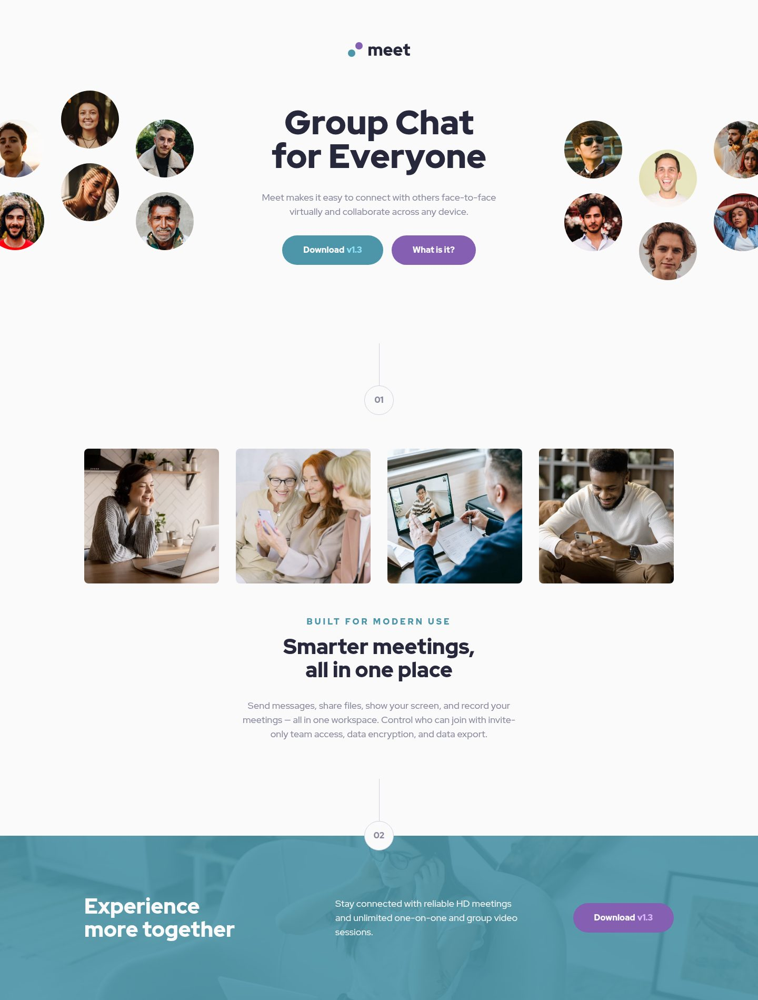

# Meet landing page 📱☕💻

My solution to the [Meet landing page](https://www.frontendmentor.io/challenges/meet-landing-page-rbTDS6OUR) challenge on Frontend Mentor.

I built it from my phone while doing my actual job. More precisely, Claude built it on my laptop while I did my actual job, and every so often I checked my phone and sent the next instruction. I showed the result to a coworker. They asked how long it took. I told them it took about as long as my workday, but I wasn't really there for most of it.



<details>
<summary>📱 Mobile view</summary>


</details>

## Table of contents

- [How it was built: remote management](#how-it-was-built-remote-management)
- [The delegation log](#the-delegation-log)
- [What Claude did between messages](#what-claude-did-between-messages)
- [Bloopers](#bloopers)
- [Built with](#built-with)
- [Running it yourself](#running-it-yourself)
- [Open issues](#open-issues)
- [Acknowledgments](#acknowledgments)

## How it was built: remote management

Think of a site supervisor who never touches a hammer. They walk by, look at the wall, say "good, now the roof," and go back to their coffee.

That was more or less my workflow:

1. **Delegate.** One short message from my phone, usually a single sentence. No specs, no essays. "Move on to the call-to-action section."
2. **Walk away.** I went back to work. The laptop kept going on its own.
3. **Come back and review.** Claude would have committed the work and reported back: what changed, what it checked, and anything it needed me to decide. The dev server listened on my home network, so I could open the page on my phone and look for myself.
4. **Approve or redirect.** "Push them." "Yes do that please." Or, sometimes, "hold on."

What I learned about delegating this way:

- **State the outcome, not the steps.** "Get the project to a working state, where I can run it myself from the terminal and preview it in my browser" was enough. Working out _how_ (the images were never copied in, the dependencies weren't installed) was Claude's job.
- **Hand over a category, not a list.** At one point I said "start on anything hard-coded into the Figma file like that." That one sentence covered the colors, fonts, spacing scale, text presets and every component measurement.
- **Defer decisions without guilt.** When a layout question came up at the 992px breakpoint, I said I'd look at it on my desktop first. It's tracked as an [open issue](#open-issues), not quietly decided for me.
- **Say so when something's off.** Once, Claude read a declined permission prompt as me not wanting the divider. I said I'd never asked to skip anything, and it built the divider right away. Short feedback works well in both directions.

## The delegation log

My actual messages, in order, sent between the other things I was doing that day. A couple of thumb-typed typos are tidied up, and long messages are trimmed with "…":

| #   | 📱 What I said                                                                                                 | 💻 What came back                                                                                                      |
| --- | -------------------------------------------------------------------------------------------------------------- | ---------------------------------------------------------------------------------------------------------------------- |
| 1   | "Analyze the repo and its commit history. Tell me about the current status of the project."                    | A status report. Short version: the HTML was finished, the CSS didn't exist yet, and every image link was broken.      |
| 2   | "Get the project to a working state, where I can run it myself from the terminal and preview it in my browser" | Copied the images in, installed the dependencies, checked that every asset loaded with a 200.                          |
| 3   | "Push the commit and then work on the theme tokens."                                                           | Pulled the exact color values out of the Figma file's binary data. The details are below.                              |
| 4   | "Push them and start on anything hard-coded into the Figma file like that"                                     | Added the font, the spacing scale and the five text presets. Wrote a local spec of every component measurement.        |
| 5   | "Yes do that please"                                                                                           | Styled the header, button and hero, then checked them in headless Chrome at 375, 768, 992 and 1440px.                  |
| 6   | "Push the commits and start the dev server so I can preview the project from my phone…"                        | Started the dev server on the LAN and gave me the address for my phone.                                                |
| 7   | "Move on to the divider, gallery, and features sections."                                                      | Styled the gallery and features section. The divider didn't happen (see Bloopers).                                     |
| 8   | "I don't know why you didn't do the divider…"                                                                  | An apology, then the divider.                                                                                          |
| 9   | "Move on to the call-to-action section"                                                                        | The call-to-action section, the last part of the page. Every breakpoint matches the design's height to within a pixel. |
| 10  | "Yes, fix the dev cache and push. Keep the hero question as an open issue"                                     | The dev server stopped crashing during builds.                                                                         |
| 11  | "…write a fun and creative README…"                                                                            | 👋 You're reading it.                                                                                                  |

Eleven messages, fifteen commits, plus the one that added this README. Every commit is small and does one thing, so the history works as a step-by-step build log too: `git log --reverse`.

## What Claude did between messages

From my side it looked like magic. From the laptop's side, it looked like this:

- **🔬 It read the Figma file's binary data.** The challenge comes with a Figma file but no style guide. A `.fig` file is a zip around Figma's compressed binary "kiwi" format. Rather than ask me to open Figma and copy hex codes, Claude wrote a small decoder in the scratchpad. That gave it every color variable, spacing step and text preset, plus the size and position of every component.
- **🎨 It measured the photo tint.** The call-to-action photo in the design is tinted cyan, but the starter image isn't. Claude compared the tinted image from the Figma file with the original. The tinted version has about 11% of the original's contrast, so the overlay is cyan at 90% opacity.
- **📐 It matched the design to within a pixel.** At 375, 768 and 1440px, the finished page is within one pixel of the height of the matching Figma frame.
- **🧪 It checked its own work.** Prettier, a Sass compile with warnings on, a production build, and headless Chrome screenshots at each breakpoint, all before every commit.
- **🎯 It used the exact colors.** Whole-number HSL shifted several colors by one step (`#4D96A9` would have become `#4D96A8`), so the palette stays in exact hex.

## Bloopers

Not everything went smoothly. Two highlights:

- **The divider standoff.** A permission prompt for the divider's stylesheet came back "denied." Maybe a stray tap on my phone, maybe something automatic. Claude took it as a decision, skipped the divider, and asked whether I'd rather write it myself as practice. I hadn't decided anything of the sort. One message later the divider was built.
- **The dev server crash.** Claude ran `npm run build` to check its work while the dev server was running for my phone. The build started by deleting `.parcel-cache`, a folder the dev server still needed, so the server crashed. Claude owned up to it, explained the cause, and offered a fix. The dev server now has its own `.parcel-dev-cache/`, and a build no longer touches it.

## Built with

- Semantic HTML5 with landmarks and `aria-labelledby` sections
- [Sass](https://sass-lang.com/) in the 7-1 pattern, using `@use`/`@forward` only
- BEM class names, one partial per component
- Design tokens straight from the Figma file:
  - `$palette` becomes `--color-*` custom properties, which map to semantic `--theme-*` tokens
  - `space(300)` gives the design's spacing steps
  - `text-preset(1)` through `text-preset(5)` apply the design's type styles
- Mobile-first layout with CSS Grid and Flexbox, plus `<picture>` to swap the images at each breakpoint
- [Parcel](https://parceljs.org/) for bundling and [Prettier](https://prettier.io/) for formatting
- [Claude Code](https://claude.com/claude-code), my remote employee for the day

## Running it yourself

```bash
npm ci
npm start          # dev server on http://localhost:4321, also reachable over your LAN
npm run build      # production build in dist/
npm run push-gh    # build and deploy to GitHub Pages
```

## Open issues

- **Where should the hero's desktop layout start?** It currently switches to the three-column desktop layout at 992px. Just past that width, the faces images are cut roughly in half by the page edge. Starting it at 1200px instead would fix that, but I want to see it on a big screen before deciding. That's the remote management style: I hand off the implementation, but this kind of decision stays mine.

## Acknowledgments

- Challenge and design by [Frontend Mentor](https://www.frontendmentor.io). The premium design files stay out of this repo, as their license requires.
- Built on my own Newbie FEM Starter Pack template.
- Every page style was written by Claude, working on my laptop while I worked on everything else.
